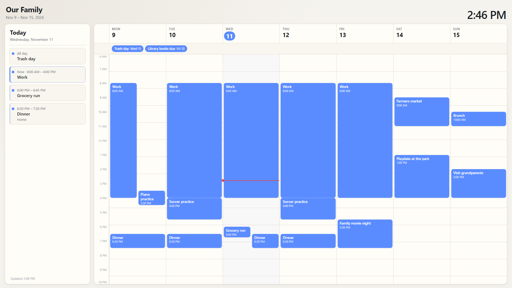

# Skylight-style Family Calendar

A wall calendar for a TV: a big, glanceable week view with a **Today** panel,
clock, optional weather, and any number of color-coded calendars merged
together. Built to run on a **Raspberry Pi 4** driving a TV over HDMI, and to
keep working when the Wi-Fi doesn't.



```
 Google / Outlook / iCloud / school ICS feeds
                    │
                    ▼
        ┌───────────────────────┐        ┌──────────────────────┐
        │  FastAPI backend      │  HTTP  │  Chromium (kiosk)    │
        │  fetch + cache +      │◄──────►│  week grid + today   │
        │  expand recurrences   │        │  clock + weather     │
        └───────────────────────┘        └──────────────────────┘
                    Raspberry Pi 4 ──────────────► TV via HDMI
```

- **Read-only.** It never changes your calendars.
- **Resilient.** Every feed is cached on disk; a network outage keeps the last
  good copy on screen.
- **No build step.** The frontend is plain HTML/CSS/JS, so the Pi only needs
  Python and Chromium.
- **Pluggable sources.** Start with ICS (5-minute setup), add the Google
  Calendar API later without touching the UI.

---

## Quick start (on your laptop first)

Requires Python 3.11+.

```bash
cd skylight
python -m venv .venv

# Windows
.venv\Scripts\activate
# macOS / Linux
source .venv/bin/activate

pip install -r requirements.txt
cp .env.example .env      # Windows: copy .env.example .env
python run.py
```

Open <http://localhost:8080>. You'll see a demo family week so you can judge the
layout immediately — no calendar setup needed.

Useful variants while developing:

- `http://localhost:8080/?theme=dark` or `?theme=light` to preview both themes
- `http://localhost:8080/api/events?start=2026-11-01T00:00:00Z&end=2026-12-01T00:00:00Z`
- `http://localhost:8080/api/docs` for the interactive API

---

## Connect real calendars

### Google Calendar (recommended: secret iCal address)

1. Open [Google Calendar](https://calendar.google.com) on the web.
2. **Settings** → select the calendar under *Settings for my calendars*.
3. Scroll to **Integrate calendar**.
4. Copy **Secret address in iCal format** (ends in `/basic.ics`).

Put it in `.env` (keeps the secret out of `config.yaml` and git):

```bash
FAMILY_ICS_URL=https://calendar.google.com/calendar/ical/…/basic.ics
```

Then in `config.yaml`:

```yaml
calendars:
  - id: family
    name: Family
    color: "#039be5"
    source:
      type: ics
      url: "${FAMILY_ICS_URL}"
      cache_ttl_seconds: 300
```

Restart the server. That's it.

> The secret URL grants read access to that calendar to anyone who has it.
> Treat it like a password.

### Multiple calendars

Add one block per feed. Colors are any hex value; these match Google's palette:

| Color | Hex | Color | Hex |
| --- | --- | --- | --- |
| Blue | `#039be5` | Yellow | `#f6bf26` |
| Green | `#33b679` | Orange | `#f4511e` |
| Purple | `#8e63ce` | Indigo | `#7986cb` |
| Red | `#e67c73` | Graphite | `#616161` |

```yaml
calendars:
  - id: family
    name: Family
    color: "#039be5"
    source: { type: ics, url: "${FAMILY_ICS_URL}" }

  - id: work
    name: Work
    color: "#33b679"
    source: { type: ics, url: "${WORK_ICS_URL}" }

  - id: school
    name: School
    color: "#f6bf26"
    source: { type: ics, url: "${SCHOOL_ICS_URL}" }
```

Everything is merged into one week view and color-coded; the Today panel lists
all calendars together.

### Outlook, iCloud, school portals

Anything that publishes an `.ics` works with `type: ics`:

- **Outlook.com**: Settings → Calendar → Shared calendars → **Publish a
  calendar** → copy the ICS link.
- **iCloud**: Calendar app → Share → **Public Calendar** → copy the `webcal://`
  link (`webcal://` is converted to `https://` automatically).
- **School / sports team**: look for "Subscribe", "Export" or "Add to calendar"
  and use the `.ics` URL, not the website URL.

If it opens a file download instead of showing a page, that's usually the right
link.

---

## Put it on the TV (Raspberry Pi 4)

### What you need

- **Raspberry Pi 4** (2 GB minimum, 4 GB comfortable; 1 GB works but Chromium is
  tight), official power supply, 16 GB+ microSD (A2) or USB SSD.
- **Raspberry Pi OS with desktop, 64-bit** (Bookworm or newer). The 64-bit build
  matters: 32-bit Chromium is slower and more memory-hungry.
- A TV over HDMI. Set the Pi's resolution to the TV's native mode in
  `raspi-config` if it doesn't pick it automatically.
- A heatsink or fan is cheap insurance; a slim case can throttle on long uptimes.

### 1. Prepare the OS

```bash
sudo apt update && sudo apt full-upgrade -y
sudo apt install -y git
sudo raspi-config
```

In `raspi-config`:

- **System Options → Boot / Auto Login → Desktop Autologin** (the kiosk needs a
  desktop session).
- **Localisation → Timezone** (also correct for HTTPS certificate checks).
- **Display Options → Screen Blanking → Disabled** (the installer also does this).

> Current Raspberry Pi OS images use **Wayland with labwc**; older Bookworm
> images may use Wayfire. The installer writes to both labwc and XDG autostart
> locations. If you are on Wayfire, see *Manual kiosk test* below.

### 2. Copy the project and configure it

```bash
cd ~
git clone <your-repo-url> skylight     # or scp the folder from your computer
cd skylight
cp config.example.yaml config.yaml
cp .env.example .env
nano config.yaml                       # set timezone, title, calendar URLs
nano .env                              # FAMILY_ICS_URL=...
```

If you copied the folder from Windows, fix line endings once:

```bash
sudo apt install -y dos2unix
dos2unix deploy/*.sh scripts/*.py
```

### 3. Install

```bash
chmod +x deploy/install.sh
./deploy/install.sh
```

The script installs Chromium and Python, creates `.venv`, sets up a
`skylight` systemd service that starts on boot, and adds the kiosk to desktop
autostart. Then:

```bash
sudo reboot
```

The calendar should appear on the TV a few seconds after the desktop loads.

### 4. Verify and operate

```bash
# from any device on the LAN
curl http://<pi-ip>:8080/api/health

journalctl -u skylight -f        # live server logs
sudo systemctl restart skylight  # after editing config.yaml or .env
```

Open `http://<pi-ip>:8080` in a browser on your phone or laptop to check the
layout before looking at the TV.

### 5. Updating

```bash
cd ~/skylight
git pull
.venv/bin/pip install -r requirements.txt
sudo systemctl restart skylight
```

The kiosk reloads itself once a day and whenever it wakes, so no manual browser
restart is usually needed.

### Manual kiosk test

If the TV shows the desktop instead of the calendar, run the kiosk script by
hand from a terminal **in the desktop session**:

```bash
SKYLIGHT_ONESHOT=1 ~/skylight/deploy/kiosk.sh
```

`SKYLIGHT_ONESHOT=1` stops it from relaunching forever so you can quit with
`Ctrl+C` and debug.

If that works, the autostart entry is the problem:

- **Wayland / labwc** (default on current Raspberry Pi OS): check that
  `~/.config/labwc/autostart` contains a line ending in
  `${HOME}/skylight/deploy/kiosk.sh &`. The trailing `&` matters.
- **X11 / LXDE**: check `~/.config/autostart/skylight-kiosk.desktop` and make
  sure its `Exec=` path is correct.
- **Wayfire** (older Bookworm images): add
  `skylight = /home/pi/skylight/deploy/kiosk.sh` under `[autostart]` in
  `~/.config/wayfire.ini`, or switch to labwc via `raspi-config` → Advanced
  Options → Wayland → labwc.

---

## Configuration reference

`config.yaml` is read at startup (set `SKYLIGHT_CONFIG=/path/to/config.yaml` to
use another file). `${VAR}` placeholders are expanded from the environment, so
secrets can live in `.env`.

### `server`

| Key | Default | Notes |
| --- | --- | --- |
| `host` | `0.0.0.0` | `0.0.0.0` makes the UI reachable from your LAN |
| `port` | `8080` | |

### `display`

| Key | Default | Notes |
| --- | --- | --- |
| `title` | `Family Calendar` | Shown top-left and in the browser tab |
| `timezone` | `America/New_York` | IANA name. Layout math uses this even if the Pi is on UTC |
| `week_starts_on` | `monday` | `monday` or `sunday` |
| `day_start_hour` | `6` | First hour in the week grid |
| `day_end_hour` | `22` | Last hour; events outside are clamped, not dropped |
| `refresh_seconds` | `60` | How often the TV polls the server (min 15) |
| `show_clock` | `true` | |
| `time_format` | `12h` | `12h` or `24h` |
| `theme` | `auto` | `auto`, `light` or `dark` |
| `accent_color` | `#5b8cff` | Today highlight, buttons, focus rings |

### `weather` (optional, Open-Meteo — no API key)

| Key | Default | Notes |
| --- | --- | --- |
| `enabled` | `false` | |
| `latitude` / `longitude` | — | Required when enabled |
| `location_name` | `Home` | Shown next to the current conditions |
| `units` | `imperial` | `imperial` (F/ mph) or `metric` (C/ km/h) |

### `calendars[]`

| Key | Notes |
| --- | --- |
| `id` | Unique, stable id (used in the API) |
| `name` | Display name |
| `color` | `#rrggbb` |
| `source.type` | `ics`, `google` or `demo` |
| `source.url` | ICS URL for `ics` (https, webcal, file paths all work) |
| `source.cache_ttl_seconds` | How long a downloaded feed is fresh (default 300) |
| `source.calendar_id` | Google only: `primary` or the calendar's long id |
| `source.client_id` / `client_secret` / `refresh_token` | Google only |

`type: demo` generates a sample family week relative to today — handy for
testing the layout, useless for real life.

---

## Optional: Google Calendar API instead of ICS

ICS is simpler and fine for most families. Use the API when you want faster
updates, many calendars without many URLs, or per-event colors later.

1. In [Google Cloud Console](https://console.cloud.google.com/), create a
   project and enable **Google Calendar API**.
2. Configure the OAuth consent screen (External, add yourself as a test user).
3. **Credentials → Create credentials → OAuth client ID → Desktop app**, then
   download the JSON.
4. On your computer (not necessarily the Pi):

   ```bash
   python scripts/google_auth.py ~/Downloads/client_secret_xxx.json
   ```

   A browser opens; approve read-only calendar access. The script prints a
   refresh token.
5. Put the three values in `.env`:

   ```bash
   GOOGLE_CLIENT_ID=...
   GOOGLE_CLIENT_SECRET=...
   GOOGLE_REFRESH_TOKEN=...
   ```

6. Use a `google` source in `config.yaml` (see `config.example.yaml`).

The scope requested is `calendar.readonly`. Tokens are stored only on your Pi.

---

## HTTP API

| Endpoint | Purpose |
| --- | --- |
| `GET /api/health` | Liveness, version, configured calendar ids |
| `GET /api/config` | Public display settings (never secrets) |
| `GET /api/events?start=…&end=…` | Merged events; `days=7` computes from this week |
| `GET /api/weather` | Current conditions + 3-day outlook |
| `GET /api/docs` | Interactive OpenAPI docs |

Event shape:

```json
{
  "id": "family:abc123:2026-11-11T13:00:00+00:00",
  "calendarId": "family",
  "calendarName": "Family",
  "color": "#039be5",
  "title": "Soccer practice",
  "start": "2026-11-11T16:00:00-05:00",
  "end": "2026-11-11T17:30:00-05:00",
  "allDay": false,
  "location": "Field 3",
  "description": null
}
```

`errors` in the response maps a calendar id to a message when its feed failed;
the UI keeps showing the cached copy in that case.

---

## Troubleshooting

**The TV shows a white/blank page.**
Check `curl http://localhost:8080/api/health`. If that fails, the service isn't
running: `journalctl -u skylight -n 50`. If it succeeds, the kiosk URL or
autostart is wrong.

**"Family couldn't refresh — showing the last saved copy."**
The feed URL is wrong, expired, or the network is down. Test it:

```bash
curl -sI "https://…/basic.ics" | head
```

You want `200` and a `text/calendar` content type. A Google Calendar **public
HTML** link won't work — use the *secret iCal* address.

**Times are wrong / off by hours.**
Set `display.timezone` in `config.yaml` *and* the Pi's system timezone
(`sudo timedatectl set-timezone America/New_York`). The UI uses the config
timezone, but the OS clock must be right for HTTPS.

**Nothing from a recurring event.**
Some feeds publish recurrence rules the expander can't handle. Check the server
log for `Could not expand recurring events`; exporting the calendar as ICS from
the provider and importing it into Google Calendar usually fixes the feed.

**Chromium is sluggish or crashes on the Pi 4.**
Confirm 64-bit Raspberry Pi OS (`uname -m` → `aarch64`), close other desktop
apps, and give the Pi airflow. On a 1 GB Pi, expect to wait longer after boot.
The kiosk profile lives in `/tmp` to spare the SD card; it is rebuilt at boot.

**Screen goes dark after a few minutes.**
`sudo raspi-config nonint do_blanking 1`, then reboot. On Wayland sessions
`xset` cannot help; the raspi-config setting is the reliable fix.

**I edited config.yaml but nothing changed.**
The service caches config at startup: `sudo systemctl restart skylight`.
Static files are served fresh, but hard-reload the kiosk with
`pkill chromium` (it relaunches on next login) if needed.

**Chromium shows an error page for a few seconds at boot.**
The kiosk script waits up to 60 seconds for `http://localhost:8080/api/health`
before opening the browser. If it still appears, the backend failed to start —
`journalctl -u skylight -n 50`.

---

## Exposing it beyond your LAN

The server has no login because it is meant for a trusted home network, and it
is read-only. Do **not** port-forward it to the internet. If you want to check
the calendar remotely, use a VPN such as [Tailscale](https://tailscale.com) or
put it behind an authenticating reverse proxy. Treat the `/api/events` output
as private family data.

---

## Tests

```bash
pip install -r requirements-dev.txt
python -m pytest
```

Covers ICS recurrence expansion, all-day handling, config validation, and the
API contract (17 tests, no network required).

---

## Project layout

```
skylight/
├── app/
│   ├── config.py          # YAML loading, validation, env expansion
│   ├── main.py            # FastAPI routes
│   ├── service.py         # merge calendars, isolate failures
│   ├── weather.py         # Open-Meteo client + WMO code mapping
│   ├── sources/
│   │   ├── base.py        # Event + CalendarSource protocol
│   │   ├── ics.py         # ICS fetch, disk cache, RRULE expansion
│   │   ├── demo.py        # sample week
│   │   └── google.py      # optional Calendar API source
│   └── static/            # index.html, style.css, app.js
├── deploy/
│   ├── install.sh         # Pi 4 installer
│   ├── kiosk.sh           # Chromium kiosk launcher
│   ├── skylight.service   # example systemd unit
│   └── skylight-kiosk.desktop
├── scripts/google_auth.py # one-time OAuth refresh-token helper
├── tests/
├── config.yaml            # working demo config
└── config.example.yaml    # documented template
```

### Adding a new source type

Implement `fetch(start, end) -> list[Event]` and `aclose()` from
`app/sources/base.py`, then register it in `app/sources/__init__.py`. Sources
return timezone-aware datetimes; the service handles merging and colors.

---

## Roadmap

The architecture is deliberately boring so these are incremental:

1. **Month view** — add a `?view=month` renderer; the events endpoint already
   accepts up to 62-day ranges.
2. **Chores / meals / rewards** — a second sidebar panel backed by a tiny SQLite
   table, Skylight-style.
3. **Photo screensaver** — idle timer that fades to a slideshow, then returns to
   the calendar on motion or touch.
4. **Touch support** — swipe between weeks on a touchscreen; the layout already
   scales down to tablet widths.
